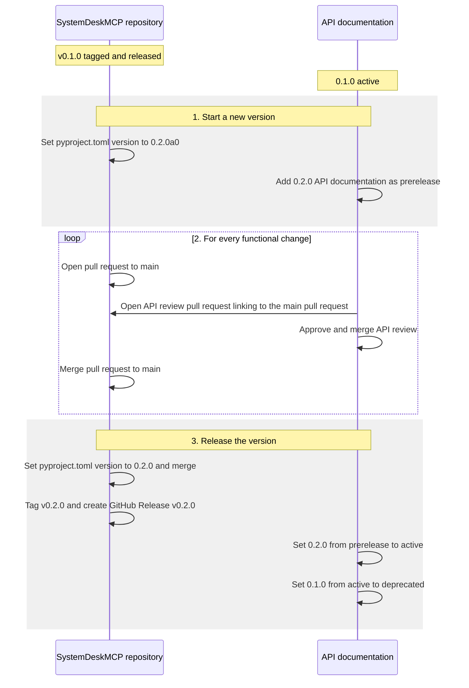

# Maintainer Guide

This guide describes how changes become customer-facing releases. Only commits with a version tag (`v*`) are intended for customers. Every functional change must pass an API review.

## Versioning and Tags

The version is defined only by `version` in [pyproject.toml](pyproject.toml), without a `v` prefix. It follows [Semantic Versioning](https://semver.org/) in the form `MAJOR.MINOR.PATCH`:

- **MAJOR**: incompatible API changes, for example removed or renamed tools, parameters, return fields, or error codes, or changed behavior.
- **MINOR**: backward-compatible features, for example new tools, new optional parameters, or new return fields.
- **PATCH**: backward-compatible bug fixes.

| Stage | `pyproject.toml` version | Git tag | GitHub Release name | API documentation |
| --- | --- | --- | --- | --- |
| In development | `0.2.0a0` | none | none | `prerelease` |
| Released | `0.2.0` | `v0.2.0` | `v0.2.0` | `active` |
| Superseded by a newer release | `0.2.0` | `v0.2.0` | `v0.2.0` | `deprecated` |

The `a0` suffix marks an unfinished alpha version that is not intended for customers. It uses [PEP 440](https://peps.python.org/pep-0440/) syntax, as required by Python packaging.

## Which Changes Need an API Review

- **Functional changes**, compatible or incompatible (for example, new tools, changed parameters, return fields, error codes, or behavior): API review required.
- **Non-functional changes** (documentation, tests, CI, and refactorings without API impact): no API review and no version change.

## Process

The example starts after `v0.1.0` was released: `0.1.0` is `active` in the API documentation.

### 1. Start a New Version

With the first functional pull request after a release:

1. In the main repository, set the version in `pyproject.toml` to the next development version, e.g. `0.2.0a0`.
2. In the API documentation, add the documentation for version `0.2.0` with state `prerelease`. `0.1.0` stays `active`.

### 2. Review Each Functional Change

For every functional change:

1. Open a pull request to `main` in the main repository.
2. Open a separate API review pull request that updates the `prerelease` API documentation.
3. Get the API review approved before merging the main pull request. In exceptional cases the review may be completed after the merge, but it must be completed before the release.

### 3. Release the Version

When development for the version is complete:

1. Ensure all API reviews for the version are approved and merged.
2. Set the version in `pyproject.toml` to the release version, e.g. `0.2.0`, and merge the change into `main`.
3. Create a tag and GitHub Release named `v0.2.0`, with release notes.
4. In the API documentation, set `0.2.0` from `prerelease` to `active`, and set all previously `active` versions to `deprecated`.

## Overview

## Release Checklist

- [ ] All functional changes for the version have an approved and merged API review.
- [ ] `pyproject.toml` version is set to the release version (e.g. `0.2.0`, no `a0` suffix) and merged into `main`.
- [ ] CI passes on `main`.
- [ ] A tag and GitHub Release named `v0.2.0` with release notes exists.
- [ ] API documentation: `0.2.0` is `active`; all previously `active` versions are `deprecated`.
